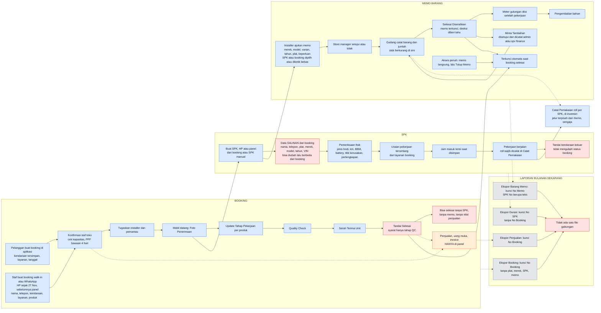
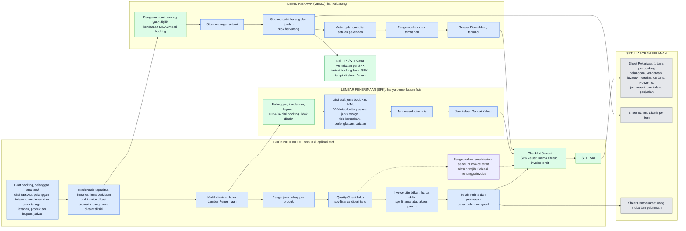

# Audit Alur Booking, SPK, dan Memo Barang

Disusun 2026-11-27 atas permintaan pemilik: memeriksa apakah alur Booking, SPK, dan Memo sudah benar, kapan dan di mana tiap data diisi, dan apakah satu laporan bulanan bisa memuat ketiganya. Bila banyak yang salah, rancangannya dirombak dan semua langkah pekerjaan dilakukan lewat aplikasi staf (bukan panel admin).

Status: audit selesai, rancangan usulan menunggu keputusan pemilik (bagian 6). Belum ada kode yang diubah untuk rombakan ini.

Diagram visual (alur sekarang dan alur usulan) ada di halaman "Alur Booking SPK Memo" (artifact) dan di bagian 7 dokumen ini.

## 1. Kesimpulan

Urutan kerja di lapangan sudah benar: pesan, konfirmasi, mobil diterima, dikerjakan, QC, serah terima. Yang lemah adalah **pengikat datanya**:

1. Ketiganya tidak wajib saling terhubung. Booking bisa selesai tanpa SPK, tanpa memo, dan tanpa nilai penjualan.
2. Data yang sama (pelanggan, kendaraan) disalin ke SPK dan memo lalu bisa berbeda.
3. Pemakaian bahan dicatat di dua tempat yang tidak saling terhubung.
4. Penjualan, uang muka, dan invoice hanya bisa diisi di panel, padahal tujuannya semua lewat aplikasi staf.
5. Laporan bulanan terpisah-pisah dan kuncinya berbeda, jadi tidak ada satu file gabungan.

Penilaian: **sebagian perlu dirombak, bukan seluruhnya.** Tahap pekerjaan, QC, serah terima, kapasitas, dan alur persetujuan memo sudah matang dan dipertahankan. Yang dirombak adalah hubungan antar ketiganya, jalur uang, dan laporan.

## 2. Cara audit

- Dibaca dari kode: rute API staf, controller, model, observer, layar aplikasi staf, form panel, dan ekspor.
- Diukur pada salinan database lokal (backup produksi 20 Nov, hanya dibaca). Catatan: rantai SPK dan memo baru dibangun 19 sampai 26 Nov, jadi data itu lebih lama dari fiturnya. Angkanya menunjukkan bahwa sistem tidak memaksa keterhubungan, bukan kebiasaan staf hari ini.

## 3. Siapa mengisi apa, kapan, dan di mana (sekarang)

| Data | Diisi di | Kapan | Oleh | Tempat sekarang |
|---|---|---|---|---|
| Pelanggan (nama, telepon) | Booking | Saat booking dibuat | Pelanggan (aplikasi) atau staf | Aplikasi pelanggan, aplikasi staf (baru 27 Nov), panel |
| Kendaraan (plat, merek, model, varian, tahun, warna, ukuran) | Booking | Saat dibuat | Sama | Sama |
| Layanan, PPF, produk per bagian | Booking | Saat dibuat | Pelanggan memilih layanan; produk oleh staf | Layanan di aplikasi; produk bagian di panel atau form Buat Booking |
| Jadwal, lama pengerjaan | Booking | Konfirmasi (lama diatur ulang dari SPK) | Staf toko | Aplikasi staf, panel |
| Installer, pemantau | Booking | Konfirmasi | Staf toko | Aplikasi staf, panel |
| Foto penerimaan, tahap, QC, serah terima | Booking | Saat mobil datang sampai selesai | Staf, installer | Aplikasi staf |
| Penjualan, uang muka, invoice | Booking atau Invoice | Setelah konfirmasi atau selesai | Staf toko | **Hanya panel** |
| Nama, telepon, alamat, plat, merek, model, varian, tahun, VIN | **SPK (salinan)** | Saat SPK dibuat | Staf | Aplikasi staf, panel |
| Jenis bodi, km, BBM, battery, titik kerusakan, perlengkapan | SPK | Saat mobil diterima | Staf, installer | Aplikasi staf, panel. BBM dan Battery selalu tampil dua-duanya, karena belum ada data jenis tenaga kendaraan |
| Uraian pekerjaan | SPK | Saat dibuat (tercentang dari layanan booking) | Otomatis, bisa diubah | Aplikasi staf, panel |
| Jam masuk | SPK | Terisi saat SPK disimpan | Otomatis | Aplikasi staf |
| Jam keluar | SPK | Tombol Tandai Keluar | Staf | Aplikasi staf |
| Merek, model, varian, tahun, plat, keperluan | **Memo (salinan)** | Saat memo diajukan | Installer, gudang | Aplikasi staf, panel |
| Nomor SPK dan booking | Memo | Saat memo dibuat | Pembuat memo | Dipilih dari daftar, atau diketik bebas |
| Barang, jumlah | Memo | Setelah disetujui | Gudang | Aplikasi staf, panel |
| Meter gulungan | Memo | Setelah pekerjaan | Gudang, installer | Aplikasi staf |
| Pengembalian bahan | Memo | Sesudah pekerjaan | Gudang | Aplikasi staf |
| Pemakaian roll (Catat Pemakaian) | **Inventori** | Saat pekerjaan | Staf | Aplikasi staf, panel |

## 4. Temuan

| # | Tingkat | Temuan | Bukti |
|---|---|---|---|
| 1 | Tinggi | **Tidak ada rantai wajib.** `Booking::completionBlocker()` hanya meminta tahap QC (dan QC lulus atau serah terima bila konfigurasi menyalakannya). Tidak mensyaratkan SPK, memo, atau penjualan. | Dari 4 booking selesai: 0 punya SPK, 0 punya memo, 0 punya nilai penjualan, 0 punya installer |
| 2 | Tinggi | **Memo tidak terikat.** (Catatan: tautan memo ke booking di panel dimatikan sejak 2026-11-17 (`FEATURE_MEMO_BOOKING_LINK`); rantainya memang lewat SPK, bukan langsung ke booking.) Nomor SPK di memo boleh diketik bebas, dan booking boleh kosong. Ekspor memo hanya memuat teks nomor SPK. | 5 dari 5 memo tanpa `booking_id` maupun `spk_id` |
| 3 | Tinggi | **Satu fakta, banyak salinan.** Pelanggan dan kendaraan disalin ke SPK dan memo. Tiap salinan bisa diubah, jadi bisa berbeda. | 1 dari 1 SPK memiliki plat berbeda dari bookingnya |
| 4 | Sedang | **Pemakaian bahan ada di dua jalur yang tidak bertemu.** Bahan baku dan barang habis pakai lewat memo; roll PPF/WF lewat "Catat Pemakaian" per SPK. **Koreksi 2026-11-27:** pemisahan ini disengaja (keputusan pemilik: roll tidak lagi lewat memo, `FEATURE_MEMO_PPF_WF` mati), jadi 14 pemakaian roll yang tidak tertaut ke memo itu normal, bukan duplikasi. Masalah yang tersisa: dua jalur itu tidak muncul di satu tempat untuk laporan per booking. | 14 pemakaian roll tanpa item memo (sesuai rancangan) |
| 5 | Tinggi | **Jalur uang di luar aplikasi staf.** Catat Penjualan, uang muka, dan invoice hanya di panel. Layar `sale.tsx` di aplikasi tidak terhubung ke menu. Rancangan Booking, Invoice, DP (16 Des) disetujui tetapi belum dibangun. | Bertentangan dengan tujuan "semua lewat aplikasi staf" |
| 6 | Sedang | **Tiga ukuran lama kerja.** `duration_days` (rencana kapasitas), jam masuk dan keluar SPK (aktual), dan tahap pekerjaan. Ekspor durasi memakai SPK, ekspor booking memakai rencana, dan keduanya tidak punya kunci bersama. | `JobDurationExport` kunci No SPK; `BookingExport` kunci No Booking |
| 7 | Sedang | **Siapa mengerjakan tercatat di dua tempat.** Installer booking dan installer SPK manual. Komisi memakai booking. | 4 dari 4 booking selesai tanpa installer |
| 8 | Sedang | **Laporan bulanan terpisah.** Ekspor Booking tidak memuat plat, merek, nomor SPK, atau memo. Ekspor durasi tidak memuat nomor booking. Ekspor memo tidak memuat nomor booking dan pelanggan. Tidak ada satu file gabungan. | Lihat bagian 5 |
| 9 | Sedang | **Tiga representasi "apa yang dikerjakan".** Produk rencana di booking, checklist pekerjaan di SPK (teks), dan barang aktual di memo, tanpa rekonsiliasi rencana lawan aktual. | |
| 10 | Rendah | **Langkah ganda panel dan aplikasi.** Konfirmasi, installer, dan SPK bisa di keduanya, sementara penjualan hanya di panel. | |
| 11 | Rendah | **SPK dan status booking sengaja independen** (keputusan 2026-09-25): kendaraan bisa sudah keluar sementara booking masih Dikonfirmasi. Sudah ada pengingat, tetapi tetap dua langkah manual. | |

Yang sudah baik dan dipertahankan: kapasitas dan slot jam, tahap per produk, QC dan serah terima, foto, alur persetujuan memo (pengajuan, setujui, serahkan, kunci), kunci memo setelah booking selesai, penyeragaman istilah kendaraan (27 Nov), pengingat dan notifikasi.

## 5. Laporan bulanan sekarang

| Ekspor | Kunci | Yang tidak ada |
|---|---|---|
| Booking | No Booking | Plat, merek, SPK, memo, produk |
| Durasi Kerja | No SPK | No Booking, memo |
| Barang Memo | No Memo, "SPK No" teks | No Booking, pelanggan |
| Penjualan | No Booking | SPK, memo, kendaraan |

Menyatukannya sekarang berarti menyambung empat file dengan nomor SPK yang bisa diketik bebas. Itu rapuh.

## 6. Rancangan usulan: satu pekerjaan, tiga lembar

Booking menjadi **induk tunggal**. SPK dan Memo adalah lembar di bawahnya, selalu terikat ke booking. Semua dilakukan di aplikasi staf.

1. **Booking induk wajib.** SPK manual dan memo tanpa booking dihapus. Kebutuhan "tanpa booking" dijawab oleh Buat Booking cepat di aplikasi staf (sudah dibangun 27 Nov).
2. **Data diisi sekali, anak hanya membaca.** Pelanggan dan kendaraan hanya di Booking. SPK hanya menyimpan hasil pemeriksaan fisik. Memo hanya menyimpan barang. Koreksi pelanggan atau kendaraan dilakukan di Booking dan langsung berlaku di ketiganya.
3. **Dua jalur bahan, keduanya terikat booking.** Memo untuk bahan baku dan barang habis pakai, Catat Pemakaian untuk roll PPF/WF (pemisahan ini sengaja, keputusan pemilik). Roll terikat ke booking lewat SPK, dan keduanya tampil di satu sheet Bahan di laporan.
4. **Penjualan di aplikasi staf** sesuai rancangan 16 Des: invoice draf saat konfirmasi, diterbitkan setelah QC lolos dan sebelum serah terima oleh spv finance atau akses penuh.
5. **Checklist Selesai.** Booking baru bisa Selesai bila SPK sudah dikeluarkan, memo (bila ada bahan) sudah ditutup, dan invoice terbit. Rancangan terperinci dan fasenya ada di `RANCANGAN_ULANG_ALUR_BOOKING_SPK_MEMO.md`.
6. **Satu laporan bulanan** (Excel, tiga sheet): Pekerjaan (satu baris per booking), Bahan (satu baris per item), Pembayaran. Kunci semuanya No Booking, jadi satu file dan tidak ada sambungan manual.

### Isian sasaran

| Data | Diisi di | Kapan | Dibaca oleh |
|---|---|---|---|
| Pelanggan, telepon, sumber | Booking | Dibuat | SPK, Memo, Laporan |
| Kendaraan (merek, model, varian, tahun, plat, warna, ukuran) | Booking | Dibuat, boleh dilengkapi saat mobil diterima | SPK, Memo, Laporan |
| **Jenis tenaga** (bensin, listrik, hybrid) | Booking (kendaraan) | Dibuat, atau dari Kendaraan Saya milik pelanggan | SPK memilih kolom yang tampil: bensin menampilkan BBM, listrik menampilkan Battery, hybrid menampilkan keduanya. Laporan |
| Layanan, produk per bagian | Booking | Dibuat, final saat konfirmasi | SPK (uraian pekerjaan), Laporan |
| Jadwal, lama, installer | Booking | Konfirmasi | SPK, Laporan |
| Jenis bodi, km, BBM, battery, VIN, titik kerusakan, perlengkapan | SPK | Mobil diterima | Laporan |
| Jam masuk, jam keluar | SPK | Otomatis dan Tandai Keluar | Laporan (durasi aktual) |
| Keperluan pengambilan | Memo | Pengajuan | Laporan |
| Barang, jumlah, meter, pengembalian | Memo | Gudang | Laporan, stok |
| Harga, diskon, voucher, uang muka, pelunasan | Penjualan (invoice) | Setelah konfirmasi | Laporan |

### Keputusan pemilik (2026-11-27)

| # | Pertanyaan | Jawaban |
|---|---|---|
| 1 | Booking induk wajib (hapus SPK manual dan memo tanpa booking) | Setuju |
| 2 | Satu catatan bahan | Setuju usulan: item memo satu-satunya, pemakaian roll ikut otomatis |
| 3 | SPK dan memo hanya membaca pelanggan dan kendaraan dari booking | Setuju |
| 4 | Syarat Selesai | Wajib: SPK keluar, memo ditutup (bila ada bahan), penjualan tercatat |
| 5 | Penjualan di HP | Hanya spv finance dan akses penuh. Invoice terbit SETELAH pengerjaan selesai |
| 6 | Data lama | Dibiarkan, hanya data baru memakai alur baru |
| 7 | Laporan bulanan | Acuan bulan: tanggal selesai (dua tanggal tetap tampil di tiap baris). Berubah pikiran: laporan memuat jumlah DAN nilai bahan |
| 8 | Panel | Setuju: panel tetap untuk koreksi darurat akses penuh, kalender kapasitas, master data, pengaturan dan hak akses, laporan dan ekspor, riwayat aktivitas. Buat dan ubah SPK dan memo hilang dari panel |
| 9 | Jenis tenaga | Tiga saja: bensin, listrik, hybrid |

Dua hal yang masih perlu dipastikan:

- **Keputusan 4 dan 5 bertabrakan.** Selesai mewajibkan penjualan tercatat, tetapi invoice baru terbit setelah pengerjaan selesai. Usulan: pecah menjadi dua tahap. *Pekerjaan Selesai* (syarat: QC, serah terima, SPK keluar, memo ditutup bila ada bahan), lalu *Ditutup* (syarat: invoice terbit oleh spv finance atau akses penuh; tanggal penjualan terisi). Booking baru masuk laporan penjualan setelah Ditutup, sama dengan rancangan 16 Des.
- **Langkah yang tetap di panel (keputusan 8).** Usulan: koreksi darurat akses penuh (buka kunci memo, ubah data inti booking), kalender kapasitas, master data, pengaturan dan hak akses, laporan dan ekspor, riwayat aktivitas. Buat dan ubah SPK dan memo hilang dari panel (hanya lihat).

Nilai bahan (keputusan 7): tersedia dari data yang ada. Bahan baku memakai harga beli per batch (FIFO), barang habis pakai memakai harga beli terakhir, dan roll PPF/WF memakai harga beli per meter dikali meter terpakai. Syaratnya harga beli sudah diisi di master data dan meter roll sudah diisi setelah pekerjaan; barang tanpa harga tampil kosong dan ditandai di laporan.

Catatan acuan bulan (keputusan 7): laporan memuat **dua tanggal di setiap baris**, tanggal masuk (jam masuk SPK) dan tanggal selesai. Saat mengekspor kamu memilih salah satu sebagai acuan bulan. Usulan bawaan: tanggal selesai, karena pekerjaan PPF yang masuk 30 Nov dan selesai 3 Des masuk laporan Desember, sama dengan tanggal penjualan.

### Tahapan usulan (bertahap, tiap tahap bisa dirilis sendiri)

0. Fondasi data: `booking_id` wajib di SPK dan memo, hapus kolom salinan (pelanggan, kendaraan), data lama dibiarkan.
1. Lembar Penerimaan (SPK baru) di aplikasi staf, membaca dari booking.
2. Lembar Bahan: satu catatan pemakaian bahan.
3. Penjualan dan invoice di aplikasi staf.
4. Checklist Penutup di tombol Selesai.
5. Laporan bulanan satu file.
6. Matikan jalur panel yang tidak lagi dipakai.

## 7. Diagram

### 7.1 Alur sekarang

### 7.2 Alur usulan

